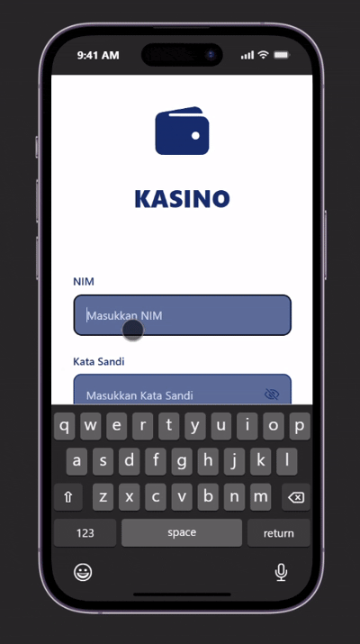
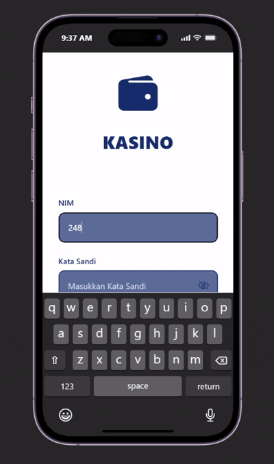

- Fitur Create digunakan oleh admin untuk menambahkan data transaksi baru ke dalam sistem, baik berupa pemasukan maupun pengeluaran. Pada transaksi pemasukan, admin mengisi informasi seperti nominal, tanggal, kategori, dan keterangan transaksi.

- Fitur Read digunakan untuk menampilkan data transaksi pemasukan dan pengeluaran yang telah tersimpan di dalam sistem. Admin dapat melihat seluruh riwayat transaksi yang tercatat, sedangkan user dapat melihat informasi saldo dan riwayat transaksi untuk mengetahui kondisi keuangan kas organisasi.

